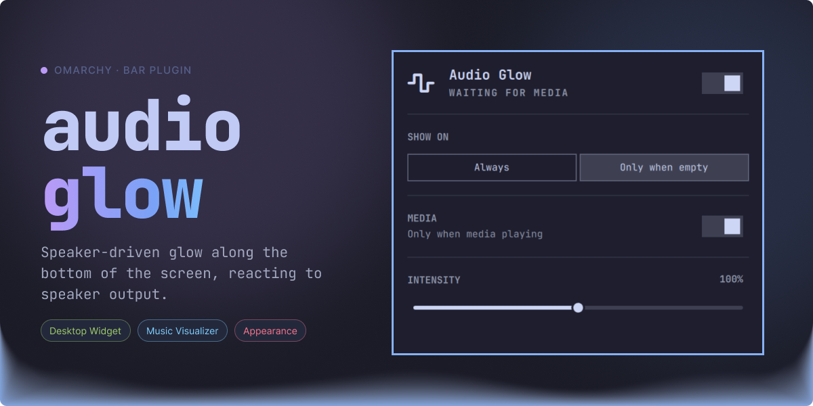

# Audio Glow



Speaker-driven Superwhisper-like glow along the bottom of the screen, reacting to speaker output.

## Requirements

The glow is drawn by Superwhisper's own indicator; it is not bundled and nothing
runs without it. It never opens the microphone.

- **Superwhisper** — `yay -S superwhisper-bin` (AUR)
- **Hyprland** with unprivileged user namespaces — the indicator is placed with `unshare -Urm`
- **cava** — `pacman -S cava`
- **util-linux** — for `unshare`
- **pactl** (optional) — `pacman -S libpulse`, to pick the default sink; otherwise cava's `auto` is used

Installed elsewhere? Point the plugin at it:

```sh
export SUPERWHISPER_INDICATOR=/path/to/superwhisper-indicator
export SUPERWHISPER_APP_DIR=/path/to/superwhisper   # optional
```

Missing requirements appear in the widget and in `qs ipc call abdxdev.audio-glow status`.

## Install

```sh
omarchy plugin add https://github.com/abdxdev/omarchy-audio-glow.git --enable
```

## Remove

```sh
omarchy plugin remove io.github.abdxdev.audio-glow
```

## Usage

- Left-click the icon to open settings.
- Right-click to toggle on/off.
- Choose Always or Only when empty.
- Optionally require media playback.
- Adjust intensity.
